<p align="center">
  
</p>

<p align="center">
  <b>Scroll less. Grow more.</b><br>
  A private, on-device counter for Instagram Reels, YouTube Shorts, Facebook Reels and TikTok.<br>
  See your short-video habits, set gentle daily limits, and stay in control. English and اردو.
</p>

<p align="center">
  <b>📲 Coming soon to Google Play</b> &nbsp;·&nbsp; <a href="#install"><b>How to install</b></a>
  &nbsp;·&nbsp;
  <a href="docs/USER_GUIDE.md"><b>📖 User guide</b></a>
  &nbsp;·&nbsp;
  <a href="https://paicons.com">paicons.com ↗</a>
</p>

---

## What it does

PAICONS Self-Development counts **each time you move to a new short video**, automatically and without you tapping anything. Then it helps you use that number kindly:

- **See today's count** at a glance, per app, with a 7-day trend.
- **Set a daily limit.** You get gentle check-ins at 50%, 75% and 100%. Nothing is ever blocked.
- **Spot your patterns.** Busiest hours, which app takes most of your time, and streaks of days under your limit.
- **Add a home-screen widget** in four sizes.
- **Use it in English or Urdu**, with a full right-to-left layout.

## How it works

<p align="center">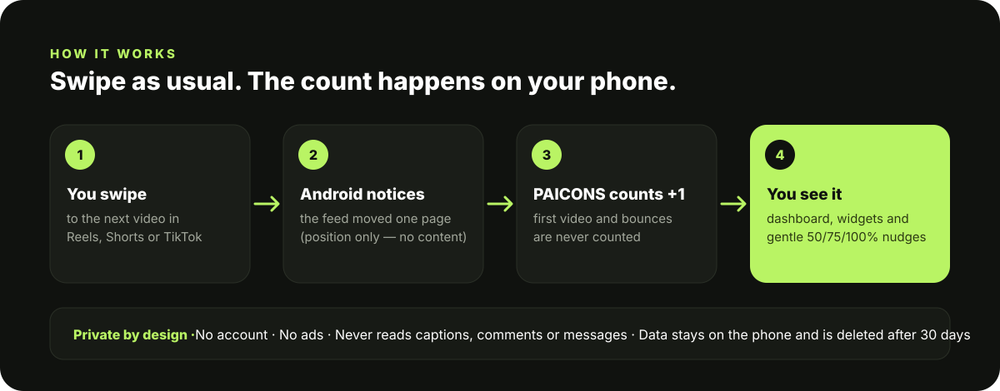</p>

The app uses Android's Accessibility service, **only inside Instagram, YouTube, Facebook and TikTok**. It reads only the **position and size** of the scrolling video area to notice when the feed moves to a new video.

It never reads or saves captions, comments, messages, creator names, video IDs or screenshots. It never taps, scrolls or blocks anything. Everything stays on your phone and is deleted after 30 days.

> **Honest numbers:** a "detected transition" means the feed moved to a new video. It isn't proof that you watched it. The first video you open isn't counted, and neither is a swipe that bounces back. Apps change their screens over time, so detection can occasionally miss. The app shows its status in *Tracking health* and never invents numbers.

## Get started in 3 steps

The app guides you through every step. Here's what you'll see:

| 1 · Read & agree | 2 · Turn on tracking | 3 · Pick a daily limit |
|:---:|:---:|:---:|
| 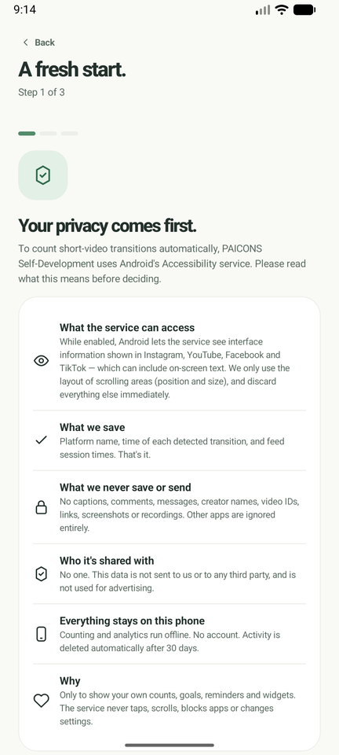 | 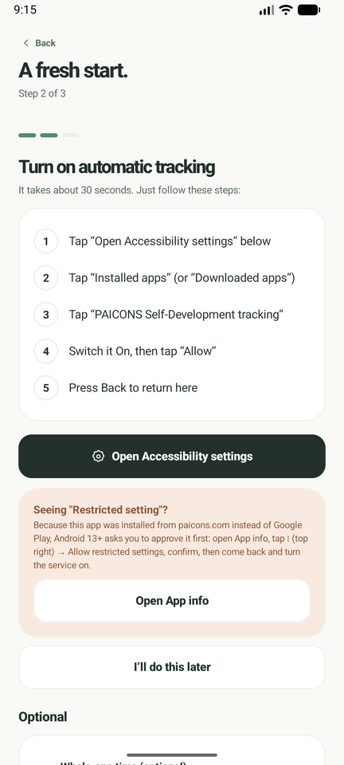 | 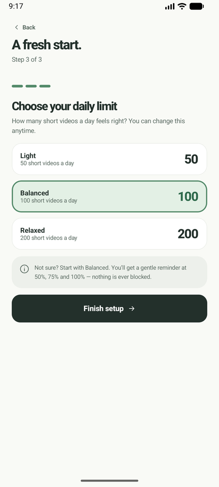 |
| See exactly what the app can access, then tap **Agree**. | Follow the 5 numbered steps. The app tells you when tracking is on. | Choose **Light (50)**, **Balanced (100)** or **Relaxed (200)**. |

After setup, a **Get started** checklist on the Home screen shows your next step until everything is ready:

| Get-started checklist | Tracking is on | All set |
|:---:|:---:|:---:|
| 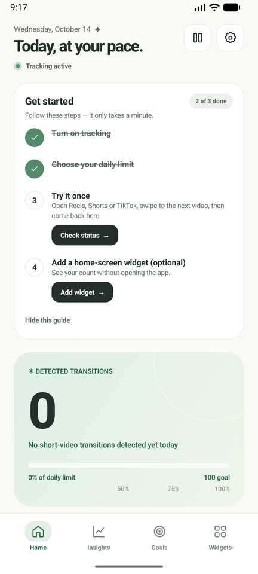 | 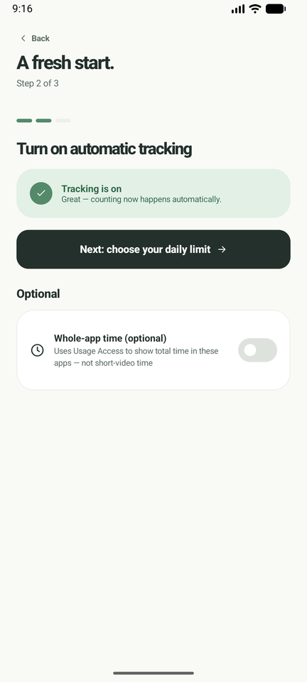 | 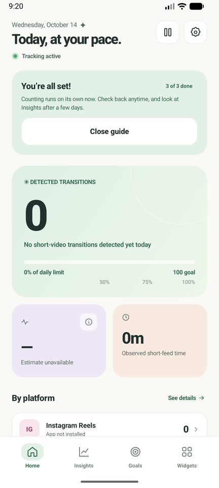 |

## A look inside

*The screenshots below use sample data.*

| Home | Insights | Goals | Widgets |
|:---:|:---:|:---:|:---:|
| 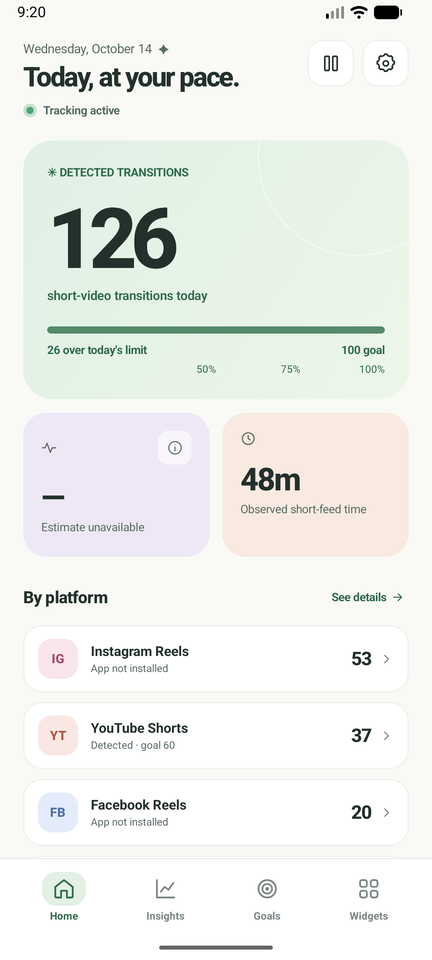 | 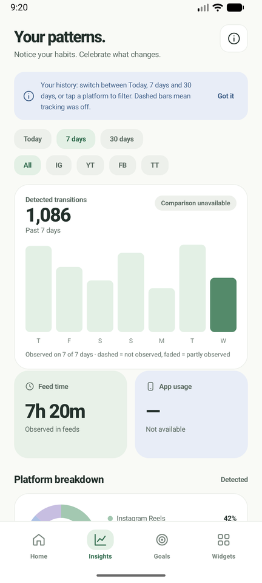 | 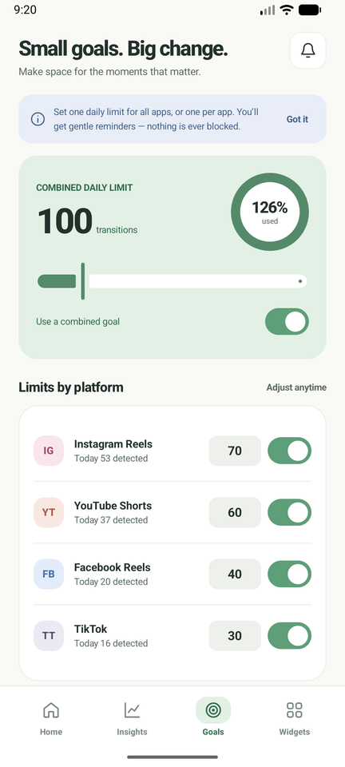 | 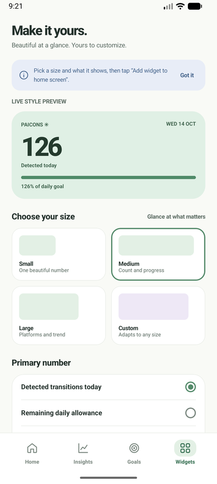 |

| Tracking health | اردو (Urdu) | Welcome |
|:---:|:---:|:---:|
| 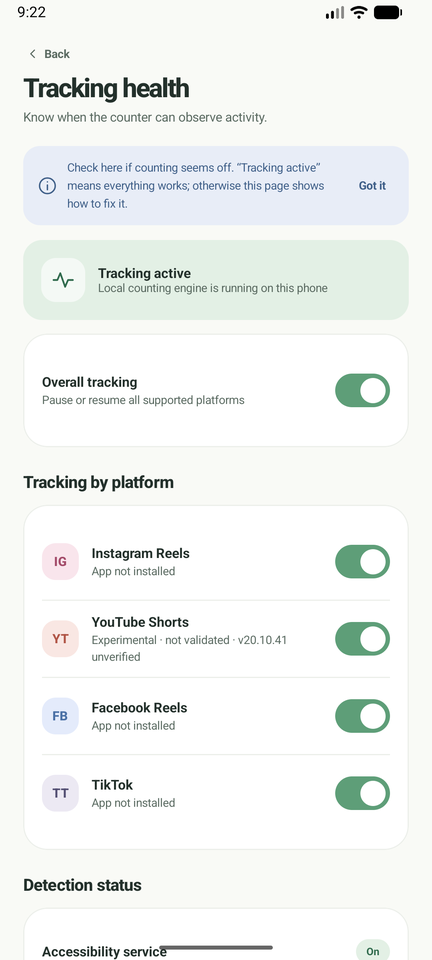 | 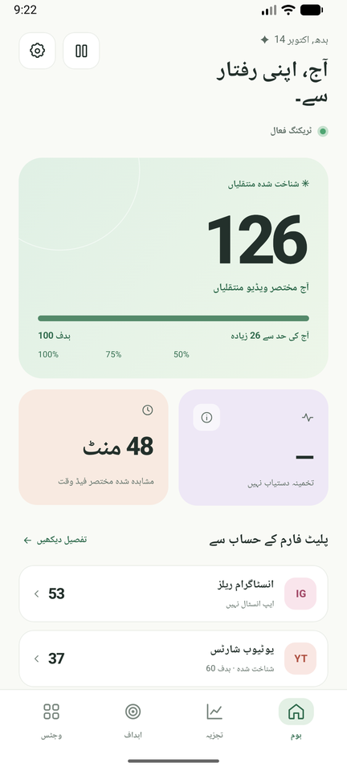 | 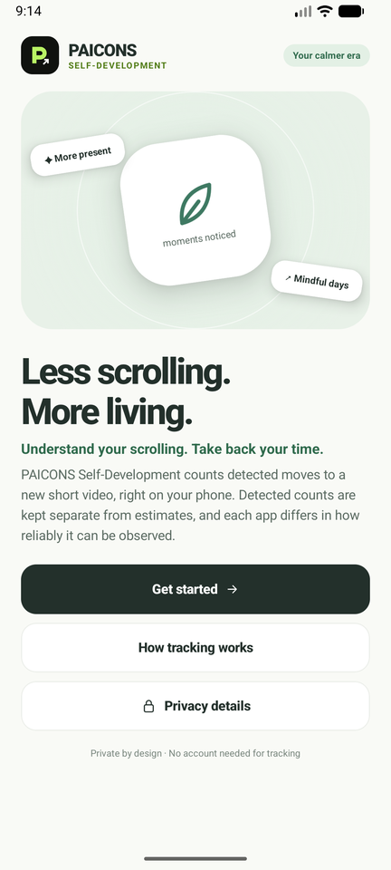 |

## Install

### Recommended: Google Play

PAICONS Self-Development is being published on **Google Play**, which is the safe, one-tap way to install it. The link will appear here as soon as the listing is live. Beta testers will receive a Google Play testing link from PAICONS.

### Why the APK file is blocked on some phones

If you download the `.apk` file and open it from a browser, WhatsApp or a file manager, some phones show **"App blocked to protect your device"** from Google Play Protect.

This happens because the app uses Android's **Accessibility service**, which is how it notices when you swipe to a new video. Google blocks *every* app that asks for this permission when it's installed from outside an app store, to stop scam apps that misuse it. Installing from Google Play avoids the block, because Google has already reviewed the app there.

> Please **don't turn off Play Protect** to get around this. It protects your phone from harmful apps. Use the Google Play version instead.

### For testers and developers: install over USB

Installing from a computer over USB with `adb` is a normal developer method, and Play Protect doesn't treat it as an internet download.

1. On the phone, enable **Developer options** (Settings → About phone → tap **Build number** 7 times). Then turn on **USB debugging**.
2. Install [Android platform-tools](https://developer.android.com/tools/releases/platform-tools) on your computer and connect the phone by USB. Accept the "Allow USB debugging?" prompt on the phone.
3. Download [`PAICONS-Self-Development-v1.1.0.apk`](https://github.com/salikahmed595/Reel-Counter/raw/main/distribution/PAICONS-Self-Development-v1.1.0.apk) to the computer, then run:

   ```bash
   adb install PAICONS-Self-Development-v1.1.0.apk
   ```

4. Open **PAICONS Self-Development** on the phone and follow the on-screen guide.

The SHA-256 of the APK is `9bf45bcfbe1dd9fb38e7fb0bc7d5108ad67ec1cbb70dcd4e466f2b47ad85564d`.

For step-by-step help with pictures, troubleshooting and FAQs, see the **[User guide](docs/USER_GUIDE.md)**.

## Privacy at a glance

| | |
|---|---|
| Account needed | **No** |
| Ads or analytics | **None** |
| What is stored | App name and time of each detected transition, plus your settings. Stored **only on your phone**. |
| What is never stored | Captions, comments, messages, creator names, video IDs, links, screenshots |
| How long | Deleted automatically after **30 days**. You can also delete everything at any time. |
| Internet | Never used for tracking or counting. Your activity is never uploaded. |

Full policy: [docs/privacy-policy.html](reel-counter-android/docs/privacy-policy.html)

---

## For developers

| Folder | What's inside |
|---|---|
| [`reel-counter-android/`](reel-counter-android) | Android app (Kotlin, Jetpack Compose, Room, Glance widgets). Product flavors: `website` (APK) and `play` (Google Play with billing). |
| [`reel-counter-billing-backend/`](reel-counter-billing-backend) | Google Play subscription verification service (Node and TypeScript on Cloud Run, Firestore, Pub/Sub RTDN). |
| [`distribution/`](distribution) | Tester APK (adb), Google Play upload guide, and a paicons.com section with a "Get it on Google Play" button. |
| [`branding/`](branding) | Logo and icon sources (SVG) and PNG exports. |
| [`docs/`](docs) | User guide and README images. |
| `Reel_Counter_Production_PRD_Blueprint.md`, `reel_counter_ui/` | Product requirements and the original UI prototype. |

Build with Android Studio 2026.2+ or from a terminal:

```bash
cd reel-counter-android
./gradlew testWebsiteDebugUnitTest     # unit tests
./gradlew assembleWebsiteRelease       # signed tester APK (install via adb; needs your keystore)
./gradlew bundlePlayRelease            # AAB for Google Play
```

Release and Google Play steps: [reel-counter-android/docs/PLAY_RELEASE.md](reel-counter-android/docs/PLAY_RELEASE.md)

## License

[MIT](LICENSE) © 2026 Salik Ahmed. PAICONS Self-Development is an independent app. It is not affiliated with Meta, Instagram, Facebook, Google, YouTube or TikTok.
