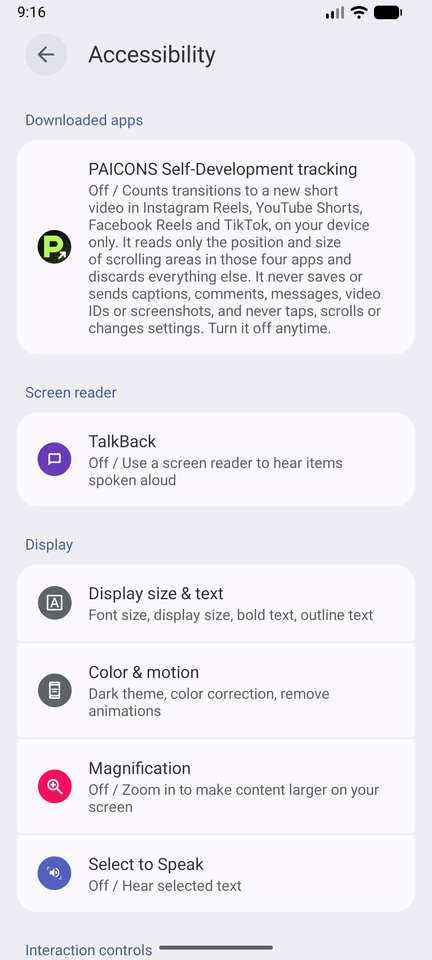

# PAICONS Self-Development: User guide

This guide walks you through installing the app, setting it up in about a minute, and using it every day. Each step has a picture.

**Contents:** [1. Install](#1-install) · [2. First-time setup](#2-first-time-setup) · [3. The Get started checklist](#3-the-get-started-checklist) · [4. Everyday use](#4-everyday-use) · [5. Widgets](#5-add-a-home-screen-widget) · [6. Settings & language](#6-settings--language) · [7. Troubleshooting](#7-troubleshooting) · [8. FAQ](#8-faq)

---

## 1. Install

1. On your Android phone, download **[PAICONS-Self-Development-v1.1.0.apk](https://github.com/salikahmed595/Reel-Counter/raw/main/distribution/PAICONS-Self-Development-v1.1.0.apk)**. It's also available from paicons.com.
2. Open the downloaded file from your notifications or the **Downloads** app.
3. If Android says *"For your security, your phone is not allowed to install unknown apps from this source"*, tap **Settings**, turn on **Allow from this source**, and go back.
4. Tap **Install**, then **Open**.

> Needs **Android 10 or later**. The app is about 5 MB. No account or sign-in is needed.

## 2. First-time setup

The app asks for three things, one per screen. The progress bar and "Step X of 3" show where you are.

### Step 1: Read and agree

This screen explains, in plain words:
- **what the app can access** (only the position of the scrolling video area in the four supported apps),
- **what it saves** (the app name and time of each detected transition),
- **what it never saves or sends** (captions, comments, messages, screenshots and more),
- **who it's shared with** (no one).

Tap **Agree** to continue.
Tap **Not now** if you'd like to look around first. You can turn tracking on later from the Home screen.

 

### Step 2: Turn on tracking

Follow the five numbered steps on screen:

1. Tap **Open Accessibility settings**.
2. Look under **Downloaded apps** or **Installed apps**. On some phones you tap it first.
3. Tap **PAICONS Self-Development tracking**.
4. Switch it **On**, then tap **Allow**.
5. Press **Back** to return to the app.

 

 &nbsp; 

*Left: what Android's Accessibility screen looks like. Right: when you come back, the app confirms **Tracking is on**.*

> **"Restricted setting" message (Android 13+)?** Phones protect apps that weren't installed from Google Play. Tap **Open App info** in the app (or go to Settings → Apps → PAICONS Self-Development), tap **⋮** in the top right, choose **Allow restricted settings**, and confirm. Then repeat the steps above.

### Step 3: Pick a daily limit

Choose how many short videos a day feels right:

| Choice | Limit |
|---|---|
| **Light** | 50 a day |
| **Balanced** (suggested) | 100 a day |
| **Relaxed** | 200 a day |

Tap **Finish setup**. You can change this anytime in **Goals**.

 

## 3. The Get started checklist

At the top of **Home**, a checklist shows your next step until everything is ready:

1. **Turn on tracking**
2. **Choose your daily limit**
3. **Try it once.** Open Reels, Shorts or TikTok, swipe to the next video, and come back.
4. *(Optional)* **Add a home-screen widget**

Finished steps are ticked. When all three main steps are done, it says **You're all set!** and you can close it. You can also tap **Hide this guide** at any time.

 

## 4. Everyday use

You don't need to do anything. Just use your apps as usual and the count updates on its own.

| Screen | What it's for |
|---|---|
|  **Home** | Today's count in the big number, progress toward your limit, a separate *estimate* card (shown only when there's enough evidence), observed feed time, and a count for each app. Tap **⏸** at the top to pause tracking. |
|  **Insights** | Switch between **Today**, **7 days** and **30 days**. Tap **IG / YT / FB / TT** to filter by app. Dashed bars mean tracking was off that day; they never mean zero. |
|  **Goals** | Change your overall daily limit, or set one for each app. Turn on **Goal reminders** to get gentle check-ins at 50%, 75% and 100%, and set **Quiet hours** if you like. |
|  **Tracking health** | Open it by tapping the green **Tracking active** line on Home. It shows whether everything is working, lets you pause individual apps, and runs a **private detection check**. |

Each screen shows a one-line tip the first time you open it. Tap **Got it** to hide it.

## 5. Add a home-screen widget

1. Open the **Widgets** tab.
2. Pick a size: **Small**, **Medium**, **Large** or **Custom**.
3. Choose what it shows, such as today's count, what's left of your limit, feed time or the last 7 days.
4. Tap **Add widget to home screen** and confirm.

If your launcher doesn't support that button: long-press an empty spot on your home screen → **Widgets** → **PAICONS** → drag the size you want.

Widgets refresh when Android allows. Each one shows when it was last updated.

 

## 6. Settings & language

Open **Settings** with the ⚙ button on Home. There you can:
- **Change the language** to **English**, **اردو**, or follow your phone. The whole app switches to right-to-left in Urdu.
- **Choose the appearance**: light, dark or system.
- **Reduce motion** for fewer animations.
- **Choose how widgets update**: Balanced (saves battery) or Responsive.
- **Delete all local activity** (Privacy & permissions), which is immediate and can't be undone.
- **Withdraw consent**, which stops tracking right away.

 

## 7. Troubleshooting

| Problem | What to do |
|---|---|
| **Count isn't going up** | Open **Tracking health**. If it doesn't say *Tracking active*, follow the steps it shows. Make sure you swiped to a **new** video: the first video and swipes that bounce back aren't counted. |
| **"Permission off" after a while** | Some phones turn the service off after an update or a force-stop. Turn it on again (Setup step 2). |
| **Tracking stops in the background** | Set the app's battery usage to **Unrestricted**. Tracking health has steps for your phone brand (Samsung, Xiaomi, Oppo, Vivo and others). |
| **"Restricted setting"** | See the note in [Step 2](#step-2-turn-on-tracking). |
| **A day shows a dashed bar** | Tracking was off or paused that day. It doesn't mean you watched nothing. |
| **Numbers look different from what I expected** | Detection depends on how each social app shows its feed and may vary between app versions. The app never guesses: if it can't tell, it doesn't count. |

## 8. FAQ

**Does it read my messages or what I watch?**
No. It only notices the position of the scrolling video area in the four supported apps. It never reads captions, comments, messages or names, and never takes screenshots.

**Does it block apps when I reach my limit?**
No. It only gives gentle reminders, and you stay in control.

**Where is my data?**
Only on your phone. It isn't uploaded or backed up to the cloud, and it's deleted automatically after 30 days.

**Does it use a lot of battery?**
It's designed to be light. It reacts only to scrolling inside the four supported apps, does a small status check every 30 seconds, and records nothing but counts.

**Is it free?**
Yes. Every feature in the downloadable version is free. Optional Pro extras will be offered only through the Google Play version.

**How do I uninstall?**
Settings → Apps → PAICONS Self-Development → Uninstall. All data is removed with it.

---

PAICONS Self-Development is an independent app and is not affiliated with Meta, Instagram, Facebook, Google, YouTube or TikTok. Screenshots use sample data.
